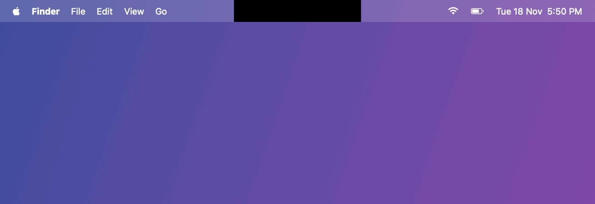
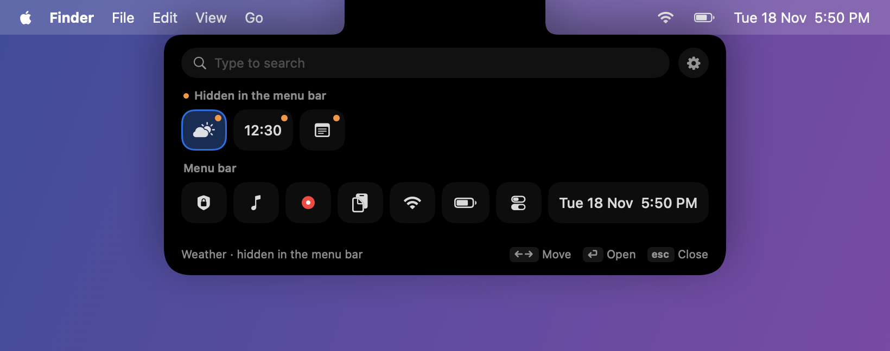
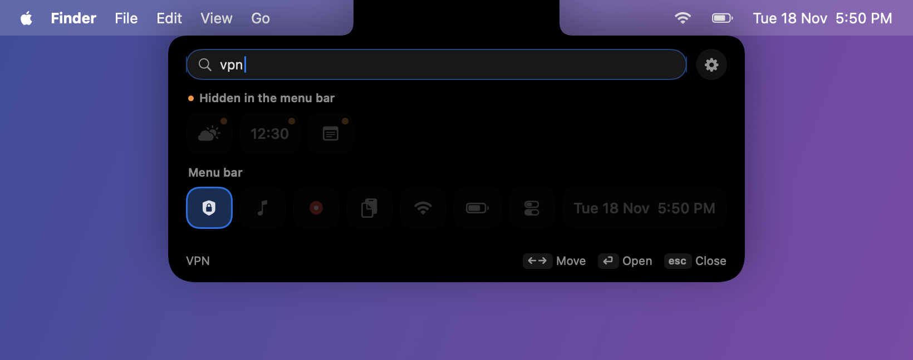
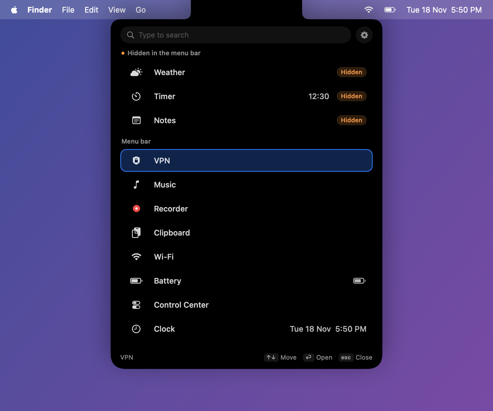
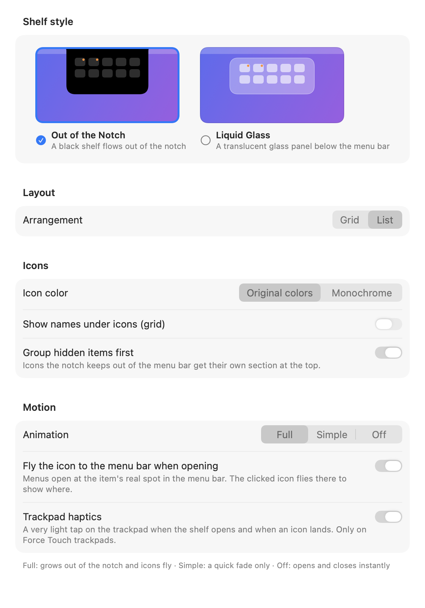
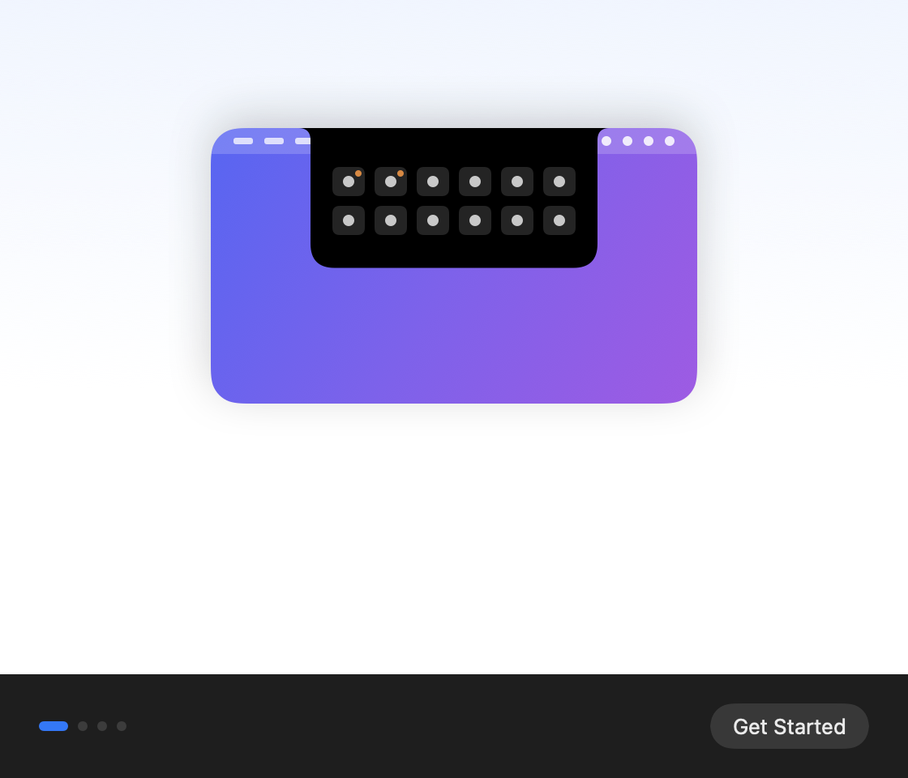

# All Menus

**Every menu bar item — even the ones hidden behind the notch — in a shelf that grows out of the notch.**

On a MacBook with a notch, menu bar items that don't fit simply disappear. All Menus collects all of them, and clicking one opens **that app's own menu**, exactly as it would from the menu bar.

<p align="center"></p>

## Features
- **Out of the notch:** rest the pointer on the notch, click it, or press **⌃⌥M**. The shelf takes only the notch's width at menu bar height and widens below it, so it never covers the menu bar.
- **The real menus:** clicking an item opens the app's actual menu or popover at its spot in the menu bar. The icon flies there first; items hidden behind the notch are drawn into the notch.
- **Hidden items stand out:** items the notch is hiding get their own section and an orange dot.
- **Search as you type:** the shelf keeps its size while you search. The grid dims what doesn't match; the list gathers the matches at the top. Korean input and initial-consonant search are supported.
- **Grid or list,** original-color or monochrome icons, pinning, reordering and hiding items.
- **Real icons:** with Screen Recording allowed, icons look exactly like they do in your menu bar.
- **Smooth:** animations run at the display's refresh rate (up to 120 Hz), and can be simplified or turned off. macOS "Reduce motion" is respected.
- **English and Korean,** following the macOS language.

<p align="center">
  
  
</p>
<p align="center"></p>

## Install
All Menus is built from source (macOS 14 or later, Apple silicon, Xcode command line tools).
```bash
git clone https://github.com/j0urneyk/AllMenus.git
cd AllMenus
./Tools/make_signing_cert.sh     # optional: keeps permissions across rebuilds (see docs/development.md)
./build.sh
cp -R "All Menus.app" ~/Applications/
open ~/Applications/"All Menus.app"
```

### Permissions
On first launch a short guide walks you through two permissions in System Settings → Privacy & Security:
- **Accessibility** (required): to read the menu bar items and open their menus. The guide moves on by itself as soon as it's allowed.
- **Screen Recording** (optional): to show the real icon images. Nothing on screen is saved or sent anywhere; without it, app icons are shown instead. macOS applies this permission after a restart, so the guide has a "Restart to Apply" button.

If a permission is on in the list but All Menus doesn't see it (this happens after the app's signature changes), select All Menus in the list, remove it with −, and add it again with +.

## Use
| | |
|---|---|
| Open | Rest the pointer on the notch (0.1 s by default), click the notch, or press ⌃⌥M |
| Pick an item | Click it, or move with the arrow keys and press ⏎ |
| Search | Just type; esc clears the search, esc again closes |
| Settings | ⚙︎ in the shelf, ⌘, , or open the app again |

When opened by resting on the notch, the shelf closes once the pointer leaves it, and it doesn't take your keystrokes until the pointer is over it (click the search box to type).

### Settings
| Tab | What's there |
|---|---|
| General | Open at login, open by resting on / clicking the notch, delay, close when the pointer leaves, shelf position |
| Shortcut | Turn the shortcut on or off, record your own key combination |
| Appearance | Grid or list, shelf style (Out of the Notch / Liquid Glass), icon color, names under icons, group hidden items, animation (Full / Simple / Off), icon flight, trackpad haptics |
| Items | Drag to reorder, ★ to pin, hide items from the shelf |
| Permissions | Status of both permissions, show the permission guide again |

<p align="center">
  
  
</p>

## Limitations
- Menus open at the item's real spot in the menu bar (near the notch for hidden items), because they are the apps' real menus.
- An app that ignores Accessibility "press" requests and is also hidden in the menu bar can't be opened.
- An icon that has never been drawn on screen is shown with its app icon until it has been.

## Documentation
- [How it works](docs/how-it-works.md): finding items, opening menus, icon images, the shelf's shape and animations, the flight
- [Development](docs/development.md): building, signing and permissions, project layout, localization, documentation images
- [Testing](docs/testing.md): the built-in verification tools and measured results

## License
MIT, see [LICENSE](LICENSE).
